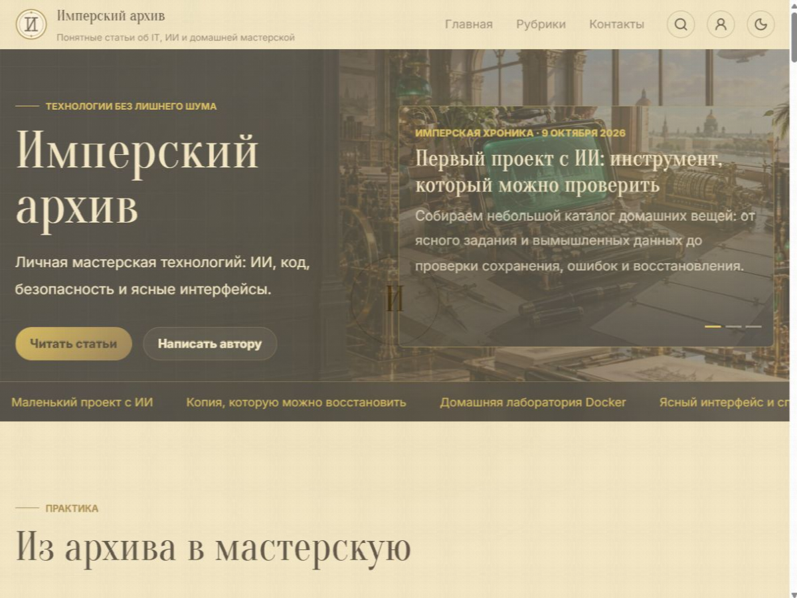

# Imperial Future

**Кастомная WordPress-тема персонального блога в стиле цифрового архива Российской Империи будущего.** Кириллическая редакционная типографика, латунь, бумага, светлое и тёмное оформление - вместе с кабинетом читателя, реакциями, Markdown-комментариями и встроенным SEO.

**Автор: [Кирилл Александров](https://kodalexandrova.ru/).**

## Скачать и установить

Текущий выпуск **1.1.4** дополняет исправления 1.1.3 полными каталогами перевода новых строк подтверждения email. Сохранены исправления приватности комментариев и подписок, загруженного аватара и Markdown-кода. [Страница темы у автора](https://kodalexandrova.ru/products/imperial-future). Предыдущие релизы сохранены без подмены архивов.

- [Установочный архив и примечания к версии 1.1.4](https://github.com/acidtmn/imperial-future/releases/tag/v1.1.4)
- [Скачать imperial-future-1.1.4.zip](https://github.com/acidtmn/imperial-future/releases/download/v1.1.4/imperial-future-1.1.4.zip)
- [Все выпуски](https://github.com/acidtmn/imperial-future/releases)

В WordPress: **Внешний вид -> Темы -> Добавить тему -> Загрузить тему**, затем активировать Imperial Future. Используй установочный ZIP из магазина автора или Releases. Автоматический архив GitHub **Source code** содержит весь репозиторий и не предназначен для загрузки как тема.

Проверенная среда исправления 1.1.3: **WordPress 7.1.3, PHP 8.3.31**. Предыдущий выпуск проверялся на WordPress 7.0. Заголовок темы допускает WordPress от 6.6, но это не проверка всех промежуточных версий. Для сервера нужны стандартные расширения WordPress, `mbstring`, DOM/XML и поддерживаемый WordPress обработчик изображений. Для публичного сайта нужен HTTPS. Node.js, Composer и Docker на сервере для установки ZIP не требуются: зависимости и production-ресурсы уже включены.

## Что внутри

- Главная с редакционным hero или слайдером избранных статей, хроникой, цитатами и блоком автора. Длительность слайдов настраивается; движение можно поставить на паузу.
- Лента с обложками, автором, рубриками, тегами, реакциями, закладками и популярным комментарием.
- Статья с нумерованным оглавлением, прогрессом чтения, виджетами и рекомендациями.
- Gutenberg для публикаций в админке; EasyMDE и безопасный серверный Markdown для комментариев.
- Древовидные комментарии, лайк/дизлайк, корректные русские окончания счётчиков.
- Реакции-эмодзи, динамические звёзды или палец вверх/вниз. Голосование для зарегистрированных пользователей.
- Компактное меню «Поделиться»: ВК, ОК, Telegram, МАКС, почта и копирование ссылки.
- Вход, регистрация, восстановление и смена пароля; кабинет с профилем, аватаром, закладками и подписками.
- Живой поиск от трёх символов, галереи с лайтбоксом, карточки внутренних и внешних ссылок.
- Контактная форма, собственная графическая капча, уведомления и еженедельный дайджест с подтверждением подписки.
- Логотипы для двух тем, favicon, локальные шрифты и иконки, семь оригинальных WebP-иллюстраций.
- Встроенные OpenGraph, Twitter Cards, JSON-LD, canonical, хлебные крошки; совместимость с SEO-плагинами и картой сайта WordPress.
- Яндекс.Метрика, VK/Яндекс OAuth, реклама в пяти позициях, код счётчиков, страница перехода на внешние сайты.
- Транслитерация ярлыков, русский интерфейс и файлы перевода; два меню и три области виджетов.
- **114 параметров в 13 разделах Customizer**, без Elementor, Bootstrap и готовой родительской темы.

## Документация

| Документ | Содержание |
| --- | --- |
| [Функции](docs/FEATURES.md) | Все подсистемы, поведение, блоки и ограничения |
| [Настройки](docs/SETTINGS.md) | Все 114 зарегистрированных параметров, варианты, диапазоны и исходные значения |
| [Установка и запуск](docs/INSTALLATION.md) | Демо, меню, SEO, почта, OAuth, обновление и откат |
| [Разработка](docs/DEVELOPMENT.md) | Структура, сборка, проверки, переводы и создание ZIP |
| [Безопасность](SECURITY.md) | Сообщение об уязвимостях и эксплуатационные ограничения |
| [История выпусков](CHANGELOG.md) | Состав версии и известные ограничения |
| [Лицензии компонентов](theme/THIRD-PARTY-NOTICES.md) | Условия библиотек, шрифтов и ресурсов |

## Первый запуск

1. Сделай резервную копию файлов и базы. Сначала проверь тему на тестовом сайте.
2. Установи ZIP, активируй тему и открой **Внешний вид -> Настроить -> Imperial Future: настройки темы**.
3. Настрой название, логотипы, значок сайта, ссылки, контакты и SEO. Демо-значения не являются твоими реквизитами.
4. По желанию запусти **Инструменты -> Демо Imperial Future**. Импорт явный, не выполняется при активации и не удаляет существующие статьи.
5. Настрой меню и виджеты. Для регистрации включи членство в общих настройках WordPress и оставь новым пользователям роль «Подписчик».
6. Подключи почтовый транспорт и проверь реальные письма. OAuth требует собственных приложений провайдеров.

## Совместимость

Исправления 1.1.3 проверены на WordPress 7.1.3 и PHP 8.3.31. Минимальная заявленная WordPress 6.6 отдельно не проверялась. Доставка писем требует почтового транспорта, социальный вход - собственных приложений VK и Яндекс. Перед установкой на рабочий сайт проверь основные сценарии на тестовой площадке.

[Требования, особенности совместимости и проверка перед запуском](docs/COMPATIBILITY.md).

Lighthouse 13.5.0 для версии **1.1.2**: главная **Performance 100 desktop / 97 mobile по медиане**, остальные категории 100. Для исправленного выпуска замеры не повторялись. Полная серия, разброс и условия измерений приведены в [совместимости](docs/COMPATIBILITY.md); скорость конкретного сайта зависит от хостинга и подключённых сервисов.

## Лицензия

Собственный код темы: [GPL-2.0-or-later](theme/LICENSE). Сторонние компоненты сохраняют отдельные условия. В частности, **GSAP использует Standard License**, поэтому весь готовый bundle не объявляется полностью GPL-совместимым. Полные тексты и реестр находятся в `theme/licenses/` и `theme/vendor/`. Эта сборка предназначена для собственного сайта и прямого распространения, **не для каталога WordPress.org**. Товарные знаки социальных сетей принадлежат их правообладателям.

Исходники и готовые ресурсы темы находятся в `theme/`. По вопросам темы обращайся через [сайт автора](https://kodalexandrova.ru/) или [GitHub Issues](https://github.com/acidtmn/imperial-future/issues), не публикуя личные данные и ключи доступа.
